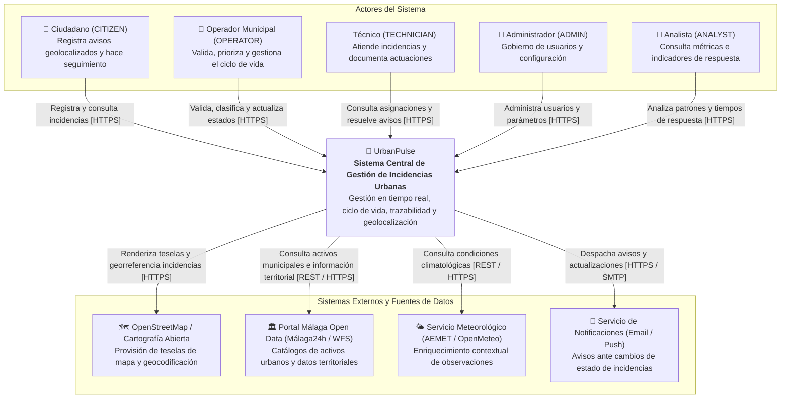
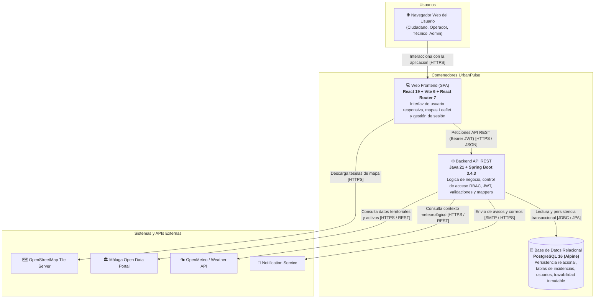
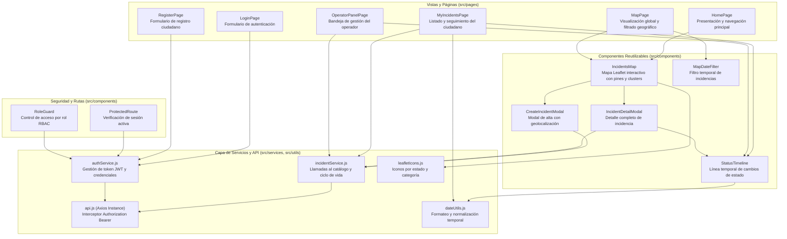

# Arquitectura del Sistema: UrbanPulse

Documento oficial de arquitectura de **UrbanPulse**, diseñado bajo el modelo **C4 (Contexto, Contenedores y Componentes)** para representar la organización estática y dinámica de la plataforma conforme a la constitución del proyecto y el código fuente real implementado.

---

## 1. Diagrama de Contexto (C4: Nivel 1)

El modelo de contexto identifica a los diferentes usuarios (actores) que interactúan con la plataforma UrbanPulse y las dependencias con los sistemas externos o fuentes de datos del entorno urbano de Málaga.

### Actores y Sistemas Externos (Contexto)

| Elemento | Tipo | Descripción y Responsabilidad |
|---|---|---|
| **Ciudadano (`CITIZEN`)** | Persona | Registra reportes con ubicación geográfica y evidencias multimedia, y consulta su historial y avance en tiempo real. |
| **Operador municipal (`OPERATOR`)** | Persona | Valida, clasifica, prioriza incidencias y actualiza su estado operativo a lo largo del flujo de trabajo. |
| **Técnico (`TECHNICIAN`)** | Persona | Consulta asignaciones de trabajo sobre el terreno, documenta actuaciones y marca resoluciones. |
| **Administrador (`ADMIN`)** | Persona | Gestiona usuarios, permisos, roles, departamentos y parámetros del sistema. |
| **Analista (`ANALYST`)** | Persona | Analiza métricas operativas, tiempos de atención, degradación de equipamiento y distribución territorial de avisos. |
| **Sistema UrbanPulse** | Software System | Plataforma central desacoplada que gestiona el ciclo de vida, la georreferenciación y la trazabilidad inmutable de incidencias urbanas. |
| **OpenStreetMap / Cartografía** | Sistema Externo | Suministra teselas cartográficas y soporte geoespacial para la visualización y geocodificación. |
| **Málaga Open Data / Datos Urbanos** | Sistema Externo | Provee datos del término municipal de Málaga (barrios, distritos y catálogo de activos de infraestructura municipal). |
| **Servicio Meteorológico** | Sistema Externo | Provee datos del clima para enriquecer contextualmente las observaciones asociadas a incidencias. |
| **Servicio de Notificaciones** | Sistema Externo | Canal para la entrega de correos electrónicos y alertas ante cambios de estado en las incidencias. |

### Relaciones del Contexto

| Origen | Destino | Interacción / Propósito | Protocolo / Formato |
|---|---|---|---|
| Ciudadano | Sistema UrbanPulse | Registra reportes y consulta el estado de sus avisos | HTTPS / JSON |
| Operador municipal | Sistema UrbanPulse | Valida, clasifica y gestiona transiciones de estado | HTTPS / JSON |
| Técnico | Sistema UrbanPulse | Consulta tareas de campo y actualiza estado de resolución | HTTPS / JSON |
| Administrador | Sistema UrbanPulse | Administra cuentas de usuario y configuraciones globales | HTTPS / JSON |
| Analista | Sistema UrbanPulse | Consulta analíticas de rendimiento y distribución espacial | HTTPS / JSON |
| Sistema UrbanPulse | OpenStreetMap | Renderiza mapas interactivos y capas cartográficas | HTTPS / Teselas Web |
| Sistema UrbanPulse | Málaga Open Data | Consulta activos urbanos y datos territoriales | HTTPS / REST / WFS |
| Sistema UrbanPulse | Servicio Meteorológico | Obtiene condiciones meteorológicas históricas o en tiempo real | HTTPS / REST API |
| Sistema UrbanPulse | Servicio de Notificaciones | Despacha notificaciones a los interesados | HTTPS / SMTP |

---

## 2. Diagrama de Contenedores (C4: Nivel 2)

Estructura de contenedores de software que componen la plataforma UrbanPulse, detallando responsabilidades tecnológicas, vías de comunicación y fronteras de persistencia.

### Contenedores Principales

| Contenedor / Servicio | Tecnología | Responsabilidad |
|---|---|---|
| **Web Frontend (SPA)** | React 19, Vite 6, React Router 7, Leaflet 1.9, Axios | Aplicación cliente en el navegador. Proporciona interfaz interactiva con mapas, formularios georreferenciados, paneles de control según RBAC y trazabilidad histórica. |
| **Backend API REST** | Java 21, Spring Boot 3.4.3, Spring Security 6, JJWT, Spring Data JPA | Núcleo del servidor: autenticación perimetral sin estado (Stateless JWT), control de acceso por roles, lógica de incidencias, transformaciones DTOs/entidades con mappers y transacciones JPA. |
| **Base de Datos Relacional** | PostgreSQL 16 (Alpine) con Docker Compose | Almacenamiento persistente de datos relacionales: cuentas de usuario, incidencias geolocalizadas, histórico inmutable de cambios de estado (`status_changes`), adjuntos y asociaciones a activos. |
| **OpenStreetMap Tile Server** | Externo (HTTPS) | Suministro de capas cartográficas para la representación gráfica en Leaflet. |
| **Málaga Open Data** | Externo (REST API / GeoJSON) | Proveedor de datos abiertos municipales de Málaga para activos y áreas urbanas. |
| **Servicio Meteorológico** | Externo (REST API) | Suministro de datos meteorológicos para contextualización de observaciones en vía pública. |
| **Servicio de Notificaciones** | Externo (SMTP / HTTPS) | Infraestructura para el envío de notificaciones y confirmaciones. |

### Relaciones de Contenedores

| Origen | Destino | Interacción / Propósito | Protocolo / Transporte |
|---|---|---|---|
| Navegador Web | Web Frontend (SPA) | Renderiza páginas, paneles y controles de interfaz | HTTPS / HTML / JS |
| Web Frontend | Backend API REST | Peticiones autenticadas de login, registro, consulta y mutación de incidencias | HTTPS / JSON / Bearer JWT |
| Web Frontend | OpenStreetMap | Carga de mapas base y teselas cartográficas | HTTPS / PNG Tiles |
| Backend API REST | PostgreSQL | Persistencia relacional y transaccional mediante repositorios Spring Data JPA | JDBC / TCP (Puerto 5432) |
| Backend API REST | Málaga Open Data | Enriquecimiento con activos e información geográfica local | HTTPS / REST / JSON |
| Backend API REST | Servicio Meteorológico | Consulta contextual de condiciones climáticas | HTTPS / REST API |
| Backend API REST | Servicio de Notificaciones | Despacho de notificaciones por eventos del ciclo de vida | HTTPS / SMTP |

---

## 3. Diagramas de Componentes (C4: Nivel 3)

### 3.1. Componentes del Contenedor Web Frontend (React 19)

Desglose de los componentes, páginas, servicios y utilidades del cliente web, alineados con la estructura real del directorio `frontend/src/`.

#### Componentes del Frontend

| Componente / Módulo | Ubicación en Código | Responsabilidad |
|---|---|---|
| **`LoginPage` / `RegisterPage`** | `src/pages/` | Vistas de autenticación y registro de ciudadanos con validaciones en cliente. |
| **`HomePage` / `MapPage`** | `src/pages/` | Vistas públicas y operativas que integran el mapa de incidencias, filtros y accesos directos. |
| **`MyIncidentsPage`** | `src/pages/` | Vista privada del ciudadano para consultar sus reportes, estados e historial inmutable. |
| **`OperatorPanelPage`** | `src/pages/` | Panel operativo con permisos `OPERATOR`/`ADMIN` para validar, clasificar y transicionar incidencias. |
| **`ProtectedRoute` / `RoleGuard`** | `src/components/` | Componentes de guardia que protegen rutas privadas y verifican roles autorizados (`CITIZEN`, `OPERATOR`, `ADMIN`). |
| **`IncidentsMap`** | `src/components/Map/` | Componente central cartográfico basado en React-Leaflet; gestiona marcadores, eventos de clic y selección. |
| **`CreateIncidentModal`** | `src/components/Map/` | Modal emergente con captura de coordenadas, título, descripción, categoría y subida de archivos adjuntos. |
| **`IncidentDetailModal`** | `src/components/Map/` | Modal de inspección de detalles de una incidencia, observaciones, adjuntos y trazabilidad de estados. |
| **`StatusTimeline`** | `src/components/Timeline/` | Línea temporal que visualiza el historial auditable de transiciones de estado de una incidencia. |
| **`authService`** | `src/services/authService.js` | Métodos de login, logout, registro y almacenamiento seguro del token JWT en sesión. |
| **`incidentService`** | `src/services/incidentService.js` | Operaciones CRUD y de gestión: listado paginado, detalle, creación, cambio de estado y geocodificación inversa. |
| **`api` (Axios Client)** | `src/services/api.js` | Cliente HTTP centralizado con interceptores que inyectan la cabecera `Authorization: Bearer <token>` y manejan códigos de error. |
| **`leafletIcons` / `dateUtils`** | `src/utils/` | Utilidades de renderizado de marcadores Leaflet según estado y formateo de fechas. |

---

### 3.2. Componentes del Contenedor Backend API (Spring Boot 3.4.3)

Desglose de la arquitectura por capas del servidor, reflejando fielmente los paquetes y clases bajo `Backend/src/main/java/org/bulbaseros/`.

```mermaid
flowchart TD
    subgraph SecurityLayer["Capa de Seguridad (org.bulbaseros.security & config)"]
        SecurityConfig["SecurityConfig<br/>Configuración perimetral, CORS y RBAC"]
        JwtFilter["JwtAuthenticationFilter<br/>Filtro perimetral de inspección Bearer JWT"]
        JwtService["JwtService<br/>Generación y validación criptográfica HMAC-SHA256"]
        AuthEntryPoint["JwtAuthenticationEntryPoint & AccessDenied<br/>Manejadores 401 y 403"]
    end

    subgraph ControllerLayer["Capa de Controladores REST (org.bulbaseros.controller)"]
        AuthController["AuthController<br/>POST /api/auth/register, /api/auth/login"]
        IncidentController["IncidentController<br/>GET, POST, PATCH /api/incidents/**"]
        GlobalException["GlobalExceptionHandler<br/>Controlador @ControllerAdvice para respuestas 4xx/5xx"]
    end

    subgraph ServiceLayer["Capa de Servicios de Negocio (org.bulbaseros.service)"]
        AuthService["AuthService<br/>Lógica de autenticación, hash BCrypt y registro"]
        IncidentService["IncidentService<br/>Gestión del ciclo de vida, transiciones y permisos"]
        AttachmentService["AttachmentService<br/>Gestión y almacenamiento de archivos adjuntos"]
        MalagaOpenDataService["MalagaOpenDataService<br/>Integración con portal de datos abiertos y geocodificación"]
    end

    subgraph MapperLayer["Capa de Mappers y DTOs (org.bulbaseros.mappers & dto)"]
        IncidentMapper["IncidentMapper<br/>Incidencia <-> IncidentResponse / CreateIncidentRequest"]
        StatusChangeMapper["StatusChangeMapper<br/>CambiosEstado <-> StatusChangeResponse"]
        AttachmentMapper["AttachmentMapper<br/>ArchivoAdjunto <-> AttachmentResponse"]
    end

    subgraph RepositoryLayer["Capa de Acceso a Datos (org.bulbaseros.repository)"]
        UserRepo["UserRepository<br/>Consulta de usuarios por email"]
        IncidentRepo["IncidenciaRepository<br/>Consultas paginadas y filtros espaciales/estado"]
        CambiosEstadoRepo["CambiosEstadoRepository<br/>Trazabilidad inmutable de transiciones"]
        ArchivoAdjuntoRepo["ArchivoAdjuntoRepository<br/>Metadatos de evidencias multimedia"]
    end

    subgraph EntityLayer["Capa de Entidades JPA (org.bulbaseros.entity)"]
        UsuarioEntity["Usuario (users)"]
        IncidenciaEntity["Incidencia (incidents)"]
        CambiosEstadoEntity["CambiosEstado (status_changes)"]
        ArchivoAdjuntoEntity["ArchivoAdjunto (attachments)"]
    end

    JwtFilter --> JwtService
    JwtFilter --> UserRepo
    AuthController --> AuthService
    IncidentController --> IncidentService

    AuthService --> JwtService
    AuthService --> UserRepo
    AuthService --> SecurityConfig

    IncidentService --> MalagaOpenDataService
    IncidentService --> AttachmentService
    IncidentService --> IncidentMapper
    IncidentService --> StatusChangeMapper
    IncidentService --> IncidentRepo
    IncidentService --> CambiosEstadoRepo
    AttachmentService --> ArchivoAdjuntoRepo
    AttachmentService --> AttachmentMapper

    IncidentRepo --> IncidenciaEntity
    UserRepo --> UsuarioEntity
    CambiosEstadoRepo --> CambiosEstadoEntity
    ArchivoAdjuntoRepo --> ArchivoAdjuntoEntity
```

#### Componentes del Backend

| Componente / Clase | Paquete / Capa | Responsabilidad |
|---|---|---|
| **`AuthController`** | `org.bulbaseros.controller` | Endpoints REST públicos `/api/auth/register` y `/api/auth/login`. Valida peticiones DTO y delega en `AuthService`. |
| **`IncidentController`** | `org.bulbaseros.controller` | Endpoints REST `/api/incidents`: alta con adjuntos (`multipart/form-data`), listado paginado, filtrado por fechas/estado, detalle por ID, actualización de estado (RBAC `OPERATOR`/`ADMIN`) y geocodificación inversa. |
| **`GlobalExceptionHandler`** | `org.bulbaseros.exception` | Interceptor global `@ControllerAdvice` que unifica los formatos de error JSON (`ErrorResponse`) con códigos semánticos (400, 401, 403, 404, 409). |
| **`SecurityConfig`** | `org.bulbaseros.config` | Define la cadena de filtros `SecurityFilterChain`, CORS permisivo para desarrollo, política sin estado (`SessionCreationPolicy.STATELESS`) y reglas de acceso RBAC por ruta. |
| **`JwtAuthenticationFilter`** | `org.bulbaseros.security` | Extrae el header `Authorization: Bearer <token>`, valida la firma con `JwtService` y establece la autenticación en el `SecurityContextHolder`. |
| **`JwtService`** | `org.bulbaseros.security` | Generación, firma digital (HMAC-SHA256) y extracción de claims (email, rol) de los tokens de sesión. |
| **`AuthService`** | `org.bulbaseros.service` | Registro de usuarios con validación de email duplicado, cifrado de contraseñas con BCrypt y autenticación de credenciales. |
| **`IncidentService`** | `org.bulbaseros.service` | Orquestador central del dominio de incidencias. Controla validaciones, reglas de transición de estado, persistencia del histórico en `CambiosEstado`, enriquecimiento territorial y delegación en mappers. |
| **`AttachmentService`** | `org.bulbaseros.service` | Gestiona el almacenamiento físico/lógico de ficheros multimedia y persiste sus metadatos asociados a la incidencia. |
| **`MalagaOpenDataService`** | `org.bulbaseros.service` | Servicio de integración para geocodificación inversa y consulta de activos e infraestructura del término municipal de Málaga. |
| **`IncidentMapper`** | `org.bulbaseros.mappers` | Transforma entidades `Incidencia` a DTOs de salida (`IncidentResponse`, `IncidentStatusResponse`) y peticiones `CreateIncidentRequest` a entidades. Garantiza que las entidades JPA no salgan de la capa de servicio. |
| **`StatusChangeMapper`** | `org.bulbaseros.mappers` | Convierte registros inmutables de auditoría `CambiosEstado` en `StatusChangeResponse` para el frontend. |
| **`AttachmentMapper`** | `org.bulbaseros.mappers` | Transforma entidades `ArchivoAdjunto` a objetos `AttachmentResponse`. |
| **`IncidenciaRepository`** | `org.bulbaseros.repository` | Acceso Spring Data JPA a la tabla `incidents` con soporte para ordenación, paginación y filtros por rango de fechas o usuario reportador. |
| **`CambiosEstadoRepository`** | `org.bulbaseros.repository` | Repositorio JPA para la consulta ordenada de la trazabilidad inmutable de estados de cada incidencia. |
| **`UserRepository`** | `org.bulbaseros.repository` | Consulta de cuentas de usuario por email y verificación de existencia. |
| **`ArchivoAdjuntoRepository`** | `org.bulbaseros.repository` | Acceso JPA a la persistencia de metadatos de archivos multimedia vinculados a incidencias. |
